<picture>
  <source media="(prefers-color-scheme: dark)" srcset="docs/readme-kit/assets/hero-dark.svg">
  
</picture>

<p align="center">
  <picture>
    <source media="(prefers-color-scheme: dark)" srcset="https://readme-typing-svg.demolab.com?font=Plus+Jakarta+Sans&weight=600&size=20&duration=2800&pause=900&color=C090F5&center=true&vCenter=true&width=760&lines=Every+stage+of+a+craft+design+workshop;Interviews+heard%2C+then+read+in+English;The+finished+report%2C+even+offline;One+API+for+web+and+Android">
    
  </picture>
</p>

<p align="center">
  
  
  
  
  
  
</p>

**Design Prototype Workshop** is the Ministry of Textiles' record of a craft design and prototype
workshop, built by the AI CoE at IIT Kharagpur. Designers capture every stage on a phone or in the
browser, at Basic, Standard and Advanced tiers; every interview is transcribed, translated into
English and made searchable; and the workshop ends with a finished Word or PDF report, written on the
phone itself when there is no signal.

<picture>
  <source media="(prefers-color-scheme: dark)" srcset="docs/readme-kit/assets/stats-dark.svg">
  
</picture>

<picture>
  <source media="(prefers-color-scheme: dark)" srcset="docs/readme-kit/assets/divider-dark.svg">
  
</picture>

## Contents

| | |
|---|---|
| [What it does](#what-it-does) | the nine things the portal is for |
| [How it works](#how-it-works) | the workshop flow and the system around it |
| [The AI suite](#the-ai-suite) | transcription, translation, Ask, drafts, quote cards, measurement, on-device models |
| [Transcripts](#transcripts) | the pipeline, the viewer, the upload choice and the admin switches |
| [Questionnaires](#questionnaires) | one engine on four clients, recording chips and filters |
| [Ministry](#ministry) | sanction orders, the annual plan, inspections and exports |
| [Data and exports](#data-and-exports) | the data browser, reports, datasets and the craft master list |
| [Offline and Android](#offline-and-android) | the outbox, the report on the phone, the release line |
| [Server and infrastructure](#server-and-infrastructure) | boxes, blue/green, memory, backups |
| [Security](#security) | roles, two-factor sign-in, consent, Aadhaar behind flags |
| [CI and releases](#ci-and-releases) | what every push proves, and how a release ships |
| [Quick start](#quick-start) | running it from a clone |
| [Documentation](#documentation) | where every question is answered |

## &nbsp; What it does

<picture>
  <source media="(prefers-color-scheme: dark)" srcset="docs/readme-kit/assets/cards-dark.svg">
  
</picture>

| Area | What a user gets | Read more |
|---|---|---|
| Capture | 22 numbered stages, declared once as data in `backend/app/services/stage_definitions.py`; the capture form, the completeness gate and the report all walk the same declaration | [DESIGN_WORKSHOP.md](docs/DESIGN_WORKSHOP.md) |
| Reports | `ReportDocument` (`backend/app/services/report_model.py`) renders to OOXML and ReportLab on the server and to `DocxWriter` / `PdfWriter` on the phone | [DESIGN_WORKSHOP.md](docs/DESIGN_WORKSHOP.md) |
| Interviews | Scribe v2 transcripts in speaker turns, English by Gemini 3.8 Flash, a karaoke viewer, copy and download in five formats | [TRANSCRIPT_PIPELINE.md](docs/TRANSCRIPT_PIPELINE.md) |
| Questionnaires | the shared engine in `backend/app/questionnaire/`, 92 features tagged on every client in `shared/questionnaire-features.json` | [ARCHITECTURE.md](docs/ARCHITECTURE.md) |
| AI help | Ask, autodraft, refine, summaries, quote cards, glossary, measurement, captions, identity OCR | [AI_FEATURES.md](docs/AI_FEATURES.md) |
| Data | `/data` browser, Excel report, streamed datasets, transcripts in every export | [DATASET_API.md](docs/DATASET_API.md) |
| Ministry | sanction orders, annual plan, inspections, ratings, dashboard, monthly packs | [MINISTRY_EXPORTS.md](docs/MINISTRY_EXPORTS.md) |
| Crafts | the Ministry's master list: 9 categories, their sub-categories and every craft, identical in both portals | [CRAFTS.md](docs/CRAFTS.md) |
| Access | eleven roles, scoped grants, two-factor sign-in, opt-out consent | [PERMISSIONS.md](docs/PERMISSIONS.md) |

## &nbsp; How it works

<picture>
  <source media="(prefers-color-scheme: dark)" srcset="docs/readme-kit/assets/pipeline-dark.svg">
  
</picture>

Both clients talk to one FastAPI service. Media never passes through it: clients upload straight to S3
with presigned URLs, and a separate queue worker does the heavy work (transcription, translation,
measurement, search indexing, e-mail) so the API stays fast.

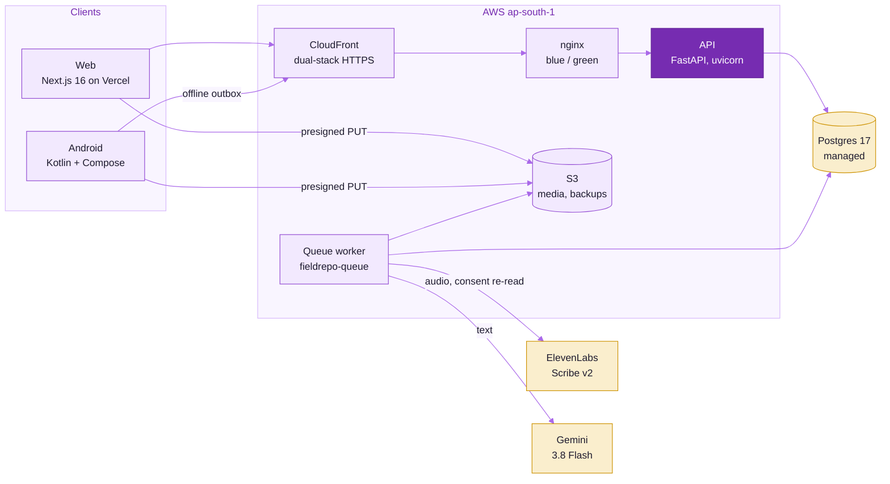

The stage set is declared once, in `backend/app/services/stage_definitions.py`, against the machinery in
`backend/app/services/stage_schema.py`. Clients fetch `GET /api/design-workshops/schema`, cache it by its
`version`, and draw every stage from it; validation, the completeness gate, the report and the research
export read the same declaration. Answers live as JSON in `DwStageEntry.data`, and a short list of
promoted fields is also written to indexed columns so lists and datasets can filter without scanning.

## &nbsp; The AI suite

<picture>
  <source media="(prefers-color-scheme: dark)" srcset="docs/readme-kit/assets/cards-ai-dark.svg">
  
</picture>

**Provider defaults.** Every text job on the deployment's key runs on **Gemini 3.8 Flash** and falls
back to **Gemini 3.7 Flash** when 3.8 answers 404. OpenAI (**GPT-6 Luna**, `gpt-6-luna`) or Anthropic
(**Claude Sonnet 5.5**, `claude-sonnet-5-5`) are used only when an operator sets `AI_TEXT_PROVIDER`, or
when a user runs their own key. Speech-to-text keeps its own ranked chain.

| Capability | Where | Model or engine | Runs |
|---|---|---|---|
| Transcription | queue worker | ElevenLabs Scribe v2, key terms from the craft | server |
| Translation, summary, quotes, craft terms | queue worker | Gemini 3.8 Flash, one structured pass | server |
| Ask this interview | transcript viewer | Gemini 3.8 Flash, answers cite the turns | server |
| Draft answers from a recording | questionnaire, transcript viewer | Gemini 3.8 Flash; drafts wait for approval | server |
| Refine transcript, refine and translate | web and Android | the deployment's text provider | server |
| Quote cards | transcript viewer | rendered image plus audio clip; withdrawn consent blocks it | server |
| Craft glossary | transcript viewer | terms Gemini heard, counted per craft | server |
| Writing help: proofread, expand, summarise, translate | stage fields | the text provider, a daily allowance per person | server |
| Grid measurement, photo captions, identity OCR | product, tool, artisan forms | `GEMINI_MEASUREMENT_MODEL` (Gemini 3.8 Flash, 3.7 on 404) | server |
| Photo geometry, identity OCR | Android | on-device geometry and ML Kit text recognition | phone |
| Dictation | Android | on-device `SpeechRecognizer`, sherpa-onnx omnilingual ASR | phone |
| Stage writing help offline | Android | Gemma 4 E2B / E4B on LiteRT | phone |
| Voice Isolator | admin switch | ElevenLabs audio isolation, off by default | server |

**Guard rails.** The two switches `AI_FEATURES_ENABLED` and `AI_TRANSCRIPT_INSIGHTS_ENABLED` gate every
route (404 while off; both are on in production). Consent is opt-out: no answer sends, a recorded
refusal sends nothing, and it is re-read immediately before every external call. Spend is capped per
portal at **USD 100 a month** (`AppSetting.transcriptMonthlyBudgetUsd`): admins are told at 80 %, and at
100 % transcription pauses and translation waits. A provider's 402 holds the job for 15 minutes without
spending an attempt; a refusal is reported as declined and never retried. Cost and model badges are
shown only to Admin, Master Admin and Ministry Admin.

## &nbsp; Transcripts

<picture>
  <source media="(prefers-color-scheme: dark)" srcset="docs/readme-kit/assets/pipeline-transcript-dark.svg">
  
</picture>

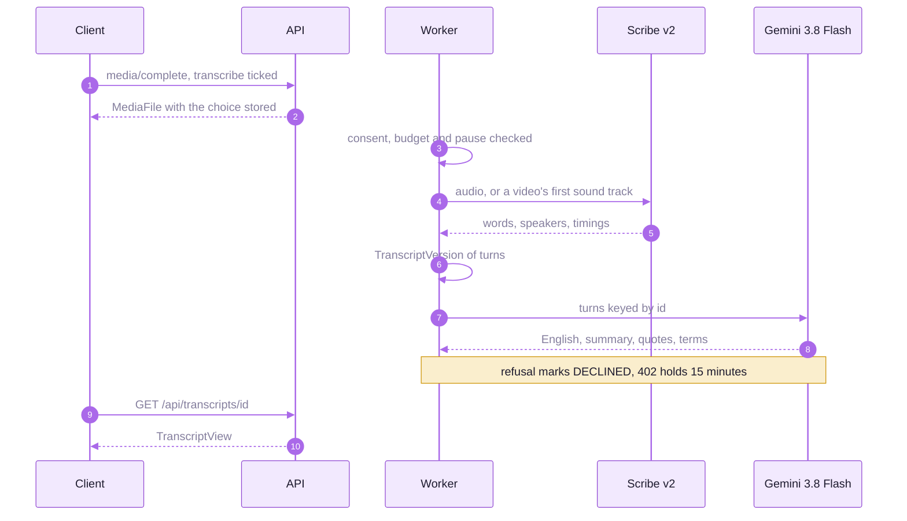

| The viewer | What it does |
|---|---|
| Tabs | Original, English, Side by side; turns already in English are marked and never sent |
| Karaoke | the playing word lights up; a video's transcript plays in a video player, synced |
| Reading mode | a clean page of turns without the controls |
| Auto-follow | the view keeps the playing turn in sight until you scroll away |
| Marks | mark a moment on the timeline; all-marks toggle, mark bubbles, per-speaker colours |
| Speakers | name each speaker once; it applies to every turn, version and copy |
| Edits | per-turn edit with history; an edited original marks its English out of date |
| Copy and download | original, English or both; Markdown, Word, `.srt`, `.vtt`, with or without timestamps |
| Declined English | an editor types or pastes it (`POST /api/transcripts/{mediaId}/english`); others see a neutral notice |
| Offline | Android keeps opened transcripts for offline reading |

**Upload choice (0.0.10).** Every non-questionnaire upload shows a *Transcribe and translate* box per
audio or video file, off by default, plus one toggle for the batch. The choice is stored on the row
(`transcribeRequested`, `transcribeRequestSource`, `transcribeRequestedAt`) and travels through the
offline outbox. Video is transcribed as its sound only: ffmpeg extracts the first audio track to the
work directory, it is sent, and it is deleted; the stored video never changes. Questionnaire takes have
no box and are always queued.

| Admin switch (Settings, master admin) | Default | Effect |
|---|---|---|
| Transcribe and translate all new videos | off | every new video is queued; the upload box shows pre-ticked and locked |
| Transcribe and translate all new audio | off | the same for audio |
| Transcribe and translate all previously uploaded media | **off (D40)** | the queue worker queues at most 25 at a time, oldest first, inside the budget; turning it on shows files, hours and cost and needs confirmation |
| Voice Isolator | off | cleans audio before it is sent |
| Transcription paused | per portal | the queue selects no transcription job |

## &nbsp; Questionnaires

One questionnaire engine (`backend/app/questionnaire/`) serves both portals, byte-identical and copied
from here by `scripts/sync_questionnaire.py`. Every feature is a row in
`shared/questionnaire-features.json` and must be tagged by a test on all four clients (designer web and
Android, Field Repository web and Android), or Checks fails.

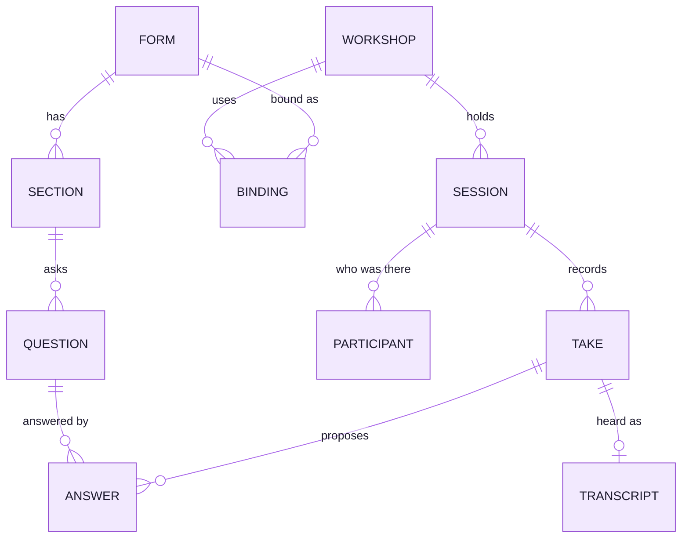

| Family | Features | Highlights |
|---|---:|---|
| A. Forms | 20 | workbook pro-forma and import, author your own, templates, kinds, locks, offline authoring |
| B. Sessions and takes | 40 | join codes and QR, coverage grid, crash-safe recording, resumable upload, revisions, inbox |
| C. Answers | 10 | voice notes, *Use as answer*, AI drafts, rich text, GPS place, merge |
| D. Rules | 4 | three section states, default forms, typed or recorded both count |
| E. Recording chips and filters | 9 | chips for section, form, artisans, dates, workshop, language, duration; tap a chip to filter; filters survive navigation and work offline on Android |
| F. Transcription choice | 7 | per-file box, batch toggle, admin switches, backfill, outbox, takes always queued |
| H, R | 2 | summary edit and regenerate, refine transcript |

## &nbsp; Ministry

Ministry and administrative surfaces are **web only** by decision
([DECISION-ministry-surfaces-web-only.md](docs/DECISION-ministry-surfaces-web-only.md)); the designer's own
work is on both clients.

| Surface | Web route | Who |
|---|---|---|
| Ministry dashboard | `/ministry-dashboard` | Ministry Admin and the directorate |
| Sanction orders, import from Excel | `/sanction-orders` | Ministry Admin, admins |
| Annual plan, Excel export | `/annual-plan` | Ministry Admin, admins |
| Workshop approvals and inspections | `/design-workshop-approvals`, `/design-workshop-inspections` | appointed directors and inspectors |
| Design review and ratings | `/design-review` | reviewers |
| Officers and designers registers | `/officers`, `/designers` | Ministry Admin, admins |
| Monthly export packs | `/ministry-exports` | built, **off** until `MINISTRY_EXPORTS_ENABLED` (D8) |
| Weekly digest | `/digest` | e-mailed summary |

## &nbsp; Data and exports

| Export | How | Notes |
|---|---|---|
| Data | `/data`: one search across artisans, tools, crafts, recordings and transcripts; the folder tree; a folder card with *Download folder* and *Report (.xlsx)*; Files, Tables and Transcripts tabs; one downloads tray | sizes before download, multi-select with a sticky bar, previews with the transcript following playback, table search on the server from a cached report, report options, saved views, workshop coverage; zips stream to disk in a background worker and keep going in a hidden tab; removed recordings never ship ([DATA_EXPLORER.md](docs/DATA_EXPLORER.md), [DATA_EXPLORER_WEB.md](docs/DATA_EXPLORER_WEB.md)) |
| Android data browser | *Data* screen: tree first, search on top, one *Download* button | zips run in the background with a notification and Cancel ([Play declaration](docs/ANDROID_BACKGROUND_DOWNLOADS.md)) |
| Data page report | subfolders load their tables, the root on click | 200-row preview searched over every row on the server, a CSV per sheet; the `.xlsx` stays complete; one build at a time, "Busy, retrying in 60 s" on `503` + `Retry-After` (D39) |
| Transcripts | a sheet in every report, `.md` / `.docx` / `.srt` / `.vtt` per recording, or all formats in one zip per recording or per folder | the hand-added English travels with every copy |
| Datasets | `/api/datasets/{name}.ndjson` and `.csv`, streamed, keyset-paged | `X-Dataset-Total` proves completeness; admin credentials only |
| Questionnaires | workbook export, artisan record CSV, corpus export | |
| Ministry packs | monthly registers-only pack | off until D8 |

**Tools across workshops** (0.0.11): a tool linked to several artisans shows under every workshop
those artisans belong to, on every read surface: the data browser, reports and `.xlsx`, the folder
zip, the dataset bundle, the tools filters, both searches and the datasets API. The tool sheet's
**Linked workshops** column names the tool's own workshop and every workshop of its artisans, and
**Artisan** names every linked artisan, both pruned to what the reader may see
([DATA_MODEL.md](docs/DATA_MODEL.md#where-a-linked-tool-shows-up-added-2026-11-04)).

The **craft master list** is the Ministry's Annexure I, seeded by migration `20261104090000_craft_master_list`
from `backend/app/data/craft_master_list.json` (byte-identical in both portals). Pickers read
`GET /crafts/catalogue` (with `ETag`); stage 1 accepts only a craft on the list.

## &nbsp; Offline and Android

The Android app (`com.designprototype.workshop`, min SDK 26, target SDK 37) keeps working with the radio
off: forms save to an outbox, media is staged, the report is written on the phone, and everything syncs
in order when a signal returns. The web has the same outbox in IndexedDB (`frontend/lib/offline.ts`).

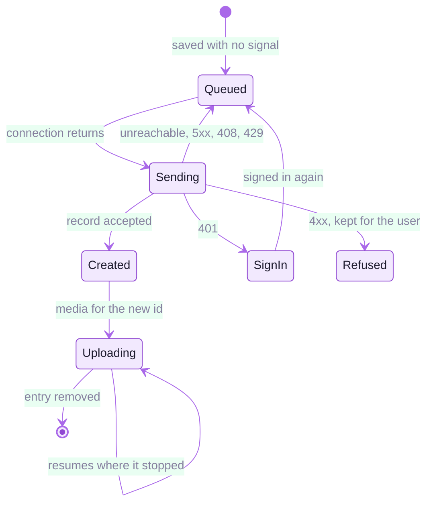

| Android | |
|---|---|
| Version | **0.0.15**, versionCode 40 (the line restarted at 0.0.1 on 21 Oct 2026; codes keep rising) |
| Toolchain | AGP 9.5, Gradle 9.8.2, Kotlin 2.4, Compose, R8 with a 4 GB Gradle heap |
| Network | CloudFront over HTTPS, dual-stack, so IPv6-only mobile networks work |
| Updates | in-app release check against the published APK; `publish-android.yml` refuses a code at or below the live one |
| Parity | everything a designer does is on both clients; ministry and admin surfaces are web only |

## &nbsp; Server and infrastructure

| Piece | Today (read 4 Nov 2026) |
|---|---|
| API box | `designrepo-api`, **t3.medium** (4 GB), Ubuntu 26.04.1, encrypted gp3 |
| Runtime | CPython 3.15.2 from python-build-standalone 20261026; the venv is built on the GitHub runner |
| Processes | `fieldrepo-api@8000` / `@8001` (blue/green behind nginx), `fieldrepo-queue` worker |
| Memory | API 281 MB + query engine 26 MB, worker 186 MB + 23 MB (PSS); 1.1 GB of 3.8 GB used |
| Swap | 2 GB `/swapfile` plus a 4 GB release swap; 46 MB in use |
| Edge | CloudFront in front, origin locked to its prefix list and an `X-Origin-Verify` header |
| Database | managed Postgres 17.11 in ap-south-1; where it runs is recorded once, in [ENVIRONMENT.md](docs/ENVIRONMENT.md) |
| Web | Vercel, Node 26.x |

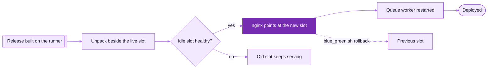

The optimisations that made the box fit, each measured before it shipped:

| Change | Effect |
|---|---|
| Prisma types split: `types.py` becomes a shim, the TypedDicts move to `types.pyi` | `import prisma` 1,434 MiB to 128 MiB; API start 87 s to 14 s |
| `from __future__ import annotations` in the generated client | import on Python 3.14+ from over 17 minutes to seconds |
| Query optimisation (0.0.2) | batched relation loads; idle sweeps once a minute instead of every pass |
| Data page report on click (0.0.9) | one build at a time, `malloc_trim(0)` after each; Field Repository API 295 MB to 166 MB |
| Transcription work directory | `TRANSCRIPTION_WORK_DIR` under the backend, 2048 MB budget, files over 180 minutes swept (D37) |
| Separate queue worker | heavy jobs never share a process with requests |

**Backups.** `backup-db.yml` dumps the public schema nightly to S3 (21:17 UTC), keeps one a week for a
year, and a second run (09:23 UTC) fails unless the dump the schedule says should exist by now is there:
today's IST date once IST is past the 02:47 slot plus six hours of grace, yesterday's before that
(`scripts/ci/backup_freshness.sh`, 0.0.9). The bucket replicates to Hyderabad. `monitor.yml` probes the API,
its readiness and the web sign-in every 15 minutes and opens an issue on an outage.

## &nbsp; Security

Eleven tiers, strictly ordered. Each inherits everything below it, and you act only on someone ranked
strictly below you. Per-user grants (`canManageQuestionnaire`, `canReview`, `canViewProvenance`,
`canDownloadDataset`) lift one capability for a lower tier.

| Tier | Rank | Powers |
| --- | --- | --- |
| `MASTER_ADMIN` | 60 | Reserved for `MASTER_ADMIN_EMAIL`. Everything, plus provider keys, repository settings and app releases. |
| `ADMIN` | 50 | Delete accounts and records, grant capabilities, decide who may sign in, grant workshop access, approve late submissions. |
| `MINISTRY_ADMIN` | 48 | **Not an admin.** Provisions password accounts below it, names a workshop's posts, reviews and rewrites records from Regional Director down. |
| `REGIONAL_DIRECTOR` | 45 | An assistant director's powers, one tier wider. Reads stage data on screen; cannot export it. |
| `ASSISTANT_DIRECTOR` | 42 | First tier that may rewrite a professor's record. Runs a workshop it holds. |
| `PROFESSOR` | 40 | Craft, workshop and questionnaire management, dataset download, editing records of anyone below. |
| `INSPECTOR` | 37 | Inspector / Reviewer: approves, rejects and sends back designers' work. Does not run workshops or sign reports. |
| `DESIGNER` | 35 | Runs workshops and signs the report: the 22 stages, custom sections, AI layers, exports. |
| `RESEARCHER` | 30 | Creates and edits their own records, runs questionnaire interviews. |
| `FIELD_CONTRIBUTOR` | 20 | Populates existing records. Cannot create them. |
| `CROWDSOURCE_VOLUNTEER` | 10 | Default for new Google accounts. Uploads media, answers questionnaires, comments. |

Running a workshop is a set (`DESIGN_WORKSHOP_ROLES`), not a rank floor: a professor outranks a
designer and still cannot run one. Whoever inspects or supervises a workshop never writes it. The full
matrix and the review state machine: [PERMISSIONS.md](docs/PERMISSIONS.md).

| Control | State |
|---|---|
| Two-factor sign-in | TOTP, six-box code entry; the secret is encrypted with `TWO_FACTOR_ENCRYPTION_KEY` (GitHub secret, SSM backup) |
| Sessions | a password change ends every other session; temporary passwords must be changed first |
| Consent | one append-only `Consent` ledger shared by both portals; opt-out, re-read before every send |
| Aadhaar | offline QR / XML and online OTP built **dark**: `AADHAAR_OFFLINE_VERIFICATION_ENABLED` and `AADHAAR_ONLINE_AUTH_ENABLED` are off until the Ministry's AUA approval (D3) |
| Database | the app connects only as Postgres; the provider's Data API is not used |
| Media | SSE on S3, type validated at upload, presigned writes only |
| Edge | CloudFront-only origin, HSTS forced, rate limits keyed on the viewer |

## &nbsp; CI and releases

Every push runs **Checks** (`checks.yml`): backend tests on a migrated Postgres, web typecheck, lint and
unit specs, browser runs of the map, questionnaire, transcript viewer and list navigation, the docs
check, packaging, questionnaire parity across both portals, the unify migration, the deploy scripts and
the **comment stripper**. The codebase carries no comments; `scripts/tools/strip_comments.py --check`
fails a push that adds one. `android-build.yml` and `android-emulator.yml` (API 37) prove the app, and
`readme-check.yml` proves every README asset and diagram.

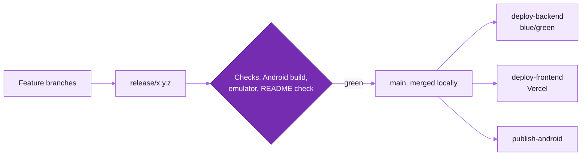

One release per platform at a time: everything is batched, checked once and deployed once.

<picture>
  <source media="(prefers-color-scheme: dark)" srcset="docs/readme-kit/assets/timeline-dark.svg">
  
</picture>

| Release | Live | Android code | What shipped |
|---|---|---:|---|
| 0.0.2 | 22 Oct 2026 | 28 | query optimisation, questionnaire phases 1 and 2, author-or-admin form edits |
| 0.0.3 | 23 Oct 2026 | 29 | one shared questionnaire engine, the parity registry, questionnaires v2 switched on |
| 0.0.4 | 31 Oct 2026 | 30 | the Scribe v2 and Gemini 3.8 Flash pipeline: speaker turns, English, summaries, the viewer with karaoke, Ask, autodraft, glossary, quote cards, the budget; recording chips and filters |
| 0.0.5 | 1 Nov 2026 | 31 | name a speaker from a sample, timeline marks, copy and download without timestamps, a parallel translation lane, the Gemini billing hold, the Voice Isolator switch |
| 0.0.6 | 1 Nov 2026 | 32 | clean previews, coverage hover, reading mode, marks, auto-follow, transcripts in the data browser, temp-file fix (D37) |
| 0.0.7 | 1 Nov 2026 | 33 | Python 3.15.2, Node 26, AGP 9.5, Gradle 9.8.2, Next 16.4 |
| 0.0.9 | 3 Nov 2026 | 34 | old transcripts translate (D38), Data page report on click (D39) |
| 0.0.10 | 4 Nov 2026 | 35 | video transcription, the upload choice, admin switches, backfill switch (off, D40), Gemini 3.8 Flash first with GPT-6 Luna and Claude Sonnet 5.5 only when selected, refine on every client, AI suggestions on Android, no comments in code, the README kit |
| 0.0.11 | 4 Nov 2026 | 36 | a tool linked to several artisans shows under every workshop those artisans belong to, on every read surface; web and Android tool rows name every linked artisan |
| 0.0.12 | 5 Nov 2026 | 37 | the data explorer: tree first with search as its toolbar and every download in one place, sizes before a download, multi-select, thumbnails and previews, table search and a CSV per sheet, all transcript formats in one zip, removed recordings never ship, audio as `.mp4` with the original as fallback, downloads that stream and resume |
| 0.0.13 | 5 Nov 2026 | 38 | the data explorer redesign: report queue and options, saved views, new-since-you-looked counts, live report links, waveforms and clear voices, the workshop overview, a transcripts `.docx`, folder counts and sizes, resumable folders, scheduled reports; Android background downloads |
| 0.0.14 | 6 Nov 2026 | 39 | every list reaches its last record on web and Android, with paging where the server stopped short; screens true to their approved design boards; the Data report shows its status filter in its options, with root questionnaires in the report; the Android publish waits for the live backend |
| 0.0.15 | 7 Nov 2026 | 40 | Android Data opens on its folders again on every phone and tablet, without flooding the server; links, saved views and locate open what they name, with the real media type and an error tone when they cannot; tablets list subfolders beside the tree; `/data/go/media` JSON names its mediaType; messages show on Data too, Back returns to the folder you were in, cluster results open their workshops, a saved view that cannot be reached says so; the backend reuses one S3 client built under a lock; Search everything clears the jump field, a record outside any folder and new errors scroll into view on tablets, and the completion matrix answers an artisan outside the chosen workshops instead of a 404; thumbnails show whole portrait photos letterboxed in their frames; a search hit with no folder opens its record page, and Open in Data is offered only where the record can be located; each recording gets its own audio player; the expanded audio view opened from a record shows size and length and has Save; the workshop overview Review column reads Approved, Pending or Partly approved with the counts beneath; a partly failed download card is amber, never green; security (sec-0017): sign-in, accounts, roles and roster hardened, one transcript-withholding rule with identity-number probes closed, media served only through short-lived signed URLs with bounded uploads and a private bucket after the cut-over, a main-only release pipeline with pinned SSH host keys, account-bound offline queues and bounded API work, spreadsheet formulas neutralised in CSV; the client address trusts forwarding headers only from a verified proxy, counted in hops; PDF and image measuring and every ffmpeg input are bounded in size, time and protocol; the paid-AI allowance is counted in the database so a restart or the queue worker shares it; expired signed media URLs refresh before display or on error; opening a quick-jump result puts the keyboard away; the Data audio service no longer restarts itself after Android kills the app; Transcripts counts read as loading, never 0; CI cancels superseded runs, skips suites a change cannot affect, shards the slowest jobs and proves each security fix fails without it; a merge undo no longer relinks a record the survivor unlinked, report extras withhold design-workshop rows from readers who may not download them, and an approval refuses AI-layer or custom-section changes made after the report was opened; held workshop drafts from another account can be kept or discarded; workshop templates are built off the event loop; migrations `password_issuer_known` and `paid_ai_spend`; photo measurement reads with `gemini-3.5-flash-lite` for now, while photo captions and identity OCR keep `gemini-3.8-flash` under their own `GEMINI_CAPTION_MODEL`; a failed media job no longer lingers once retried: a new job reuses the failed row for the same file and type (keeping the transcription parts already paid for), a completed job removes the failures it supersedes in the same transaction, and every failed list and count leaves superseded rows out; data step: `python scripts/clear_superseded_failed_jobs.py --dry-run`, then without `--dry-run`, once on each box; every Data list sorts by name, date recorded, date added, last modified, size, duration or type, and mixed lists also by workshop, artisan, craft or review status, in order across every page and remembered per person and folder level, on web and Android; Android (fix-0015-android2): system Back from a record opened in top search returns to the search with its query and results and no keyboard; every top-level screen survives process death; notifications, pending counts, the AI verb allowance and the latest release are fetched once per screen change (10 s cache, shared in-flight), form loads collapse for 3 s, and offline polling backs off and resumes when the network returns; the navigation drawer scrolls whole at large text, keeps the name on one line and asks before Push update to all; radio buttons and switches are static like the web's; a video that cannot play says so with Retry, Open in another app and Download; workshop coverage keeps its error on screen with Retry and clears it when the workshop changes |

## &nbsp; Built with

<p align="center">
  <picture>
    <source media="(prefers-color-scheme: dark)" srcset="https://skillicons.dev/icons?i=nextjs,react,ts,tailwind,py,fastapi,postgres,prisma,kotlin,androidstudio,aws,terraform,docker,githubactions,vercel&theme=dark&perline=15">
    
  </picture>
</p>

| Layer | Stack |
|---|---|
| Web | Next.js 16, React 19, Tailwind 4, framer-motion 14, GSAP 3, TypeScript 7 for checks and 6 for tooling |
| API | FastAPI on Python 3.15, prisma-client-py 0.15, ReportLab, ffmpeg |
| Android | Kotlin 2.4, Jetpack Compose, ML Kit, LiteRT, sherpa-onnx |
| Data | Postgres 17, S3 with presigned uploads, CloudFront |
| Delivery | GitHub Actions, Terraform, Vercel, systemd, nginx |

## &nbsp; Quick start

1. Start Postgres 17 and S3-compatible storage: `docker compose up -d` (Postgres on `localhost:55432`).
2. Backend, Python 3.15:

   ```sh
   cd backend
   cp .env.example .env
   python -m venv .venv && . .venv/bin/activate
   pip install -r requirements.lock && pip install -e . --no-deps
   python scripts/generate_prisma_client.py
   python -m prisma migrate deploy --schema=prisma/schema.prisma
   python scripts/seed_admin.py
   uvicorn app.main:app --reload --port 8000
   ```

3. Web, Node 26 and npm 12:

   ```sh
   cd frontend
   cp .env.local.example .env.local
   npm install && npm run dev
   ```

4. Android: open `android/` in Android Studio and set `apiBaseUrl=http://10.0.2.2:8000/api/` in
   `android/local.properties` for the emulator.

`scripts/generate_prisma_client.py` is required, not `prisma generate`: it adds the future import and
the `types.pyi` split without which the client takes minutes and gigabytes to import. Migrations are
hand-written and forward-only; never run `prisma migrate dev`. `ADMIN_PASSWORD` has no default and every
seeded password must be changed at first sign-in.

## &nbsp; Documentation

| Question | Answer |
|---|---|
| Where do I start? | [docs/README.md](docs/README.md), the index |
| How do the pieces fit? | [ARCHITECTURE.md](docs/ARCHITECTURE.md) |
| What are the stages and the report? | [DESIGN_WORKSHOP.md](docs/DESIGN_WORKSHOP.md) |
| How does a recording become English? | [TRANSCRIPT_PIPELINE.md](docs/TRANSCRIPT_PIPELINE.md) |
| Which AI runs where, and what does it cost? | [AI_FEATURES.md](docs/AI_FEATURES.md) |
| Who may do what? | [PERMISSIONS.md](docs/PERMISSIONS.md) |
| What is stored? | [DATA_MODEL.md](docs/DATA_MODEL.md) |
| Every environment variable? | [ENVIRONMENT.md](docs/ENVIRONMENT.md) |
| How does CI and deployment work? | [CI.md](docs/CI.md), [RELEASE.md](docs/RELEASE.md), [backend/DEPLOY_AWS.md](backend/DEPLOY_AWS.md) |
| How does the box hold up? | [SCALABILITY.md](docs/SCALABILITY.md) |
| How is data protected? | [SECURITY.md](docs/SECURITY.md), [AADHAAR.md](docs/AADHAAR.md) |
| How do I hand it to a designer? | [RESEARCHER_GUIDE.md](docs/RESEARCHER_GUIDE.md), [WALKTHROUGH.md](docs/WALKTHROUGH.md) |
| How many models, routes, tests? | [REPO_FACTS.md](docs/REPO_FACTS.md), generated; no count is written by hand |
| Why is the code the way it is, now that it has no comments? | [INVARIANTS.md](docs/INVARIANTS.md) |
| How is this README built? | [readme-kit/README_STYLE.md](docs/readme-kit/README_STYLE.md) |

## How this document is kept true

This file is the front page. Depth lives in [docs/](docs/README.md), and when the two disagree, `docs/`
wins and this file is the one to fix.

| Claim | Kept true by |
|---|---|
| Links and repository paths | `node docs/tools/check-docs.mjs` resolves them |
| Images, `<picture>` pairs, every mermaid block | `readme-check.yml`: the kit is rebuilt and diffed, every SVG checked, every diagram rendered by mermaid-cli and opened on github.com with Playwright (an error, a raw tag or entity, or a clipped label fails), the page rendered by `gh api markdown` |
| Model names and defaults | `backend/app/services/ai_providers.py` and `backend/app/transcription/transcript/gemini.py` |
| The transcript contract and strings | `shared/transcript-contract.json`, `shared/strings/transcript.json`, pinned by `backend/tests/test_transcript_contract.py` |
| The questionnaire feature counts | `shared/questionnaire-features.json`, checked by `backend/tests/test_questionnaire_feature_parity.py` |
| Counts of models, routes, tests | not stated here; [REPO_FACTS.md](docs/REPO_FACTS.md) is generated |
| The Tier / Rank / Powers table | `backend/tests/test_role_ladder_parity.py` against `ROLE_RANK` in `backend/app/core/deps.py` |
| Box sizes, memory, swap, the Python build | read on the boxes through SSM on 4 Nov 2026; `deploy-backend.yml` pins the Python build |
| The release table | the tags and `android/app/build.gradle.kts` (`appVersionName`, `appVersionCode`) |

**Review triggers:** a release, a provider or model default change, a new top-level directory, a change
to the local commands, or a new workflow.

<picture>
  <source media="(prefers-color-scheme: dark)" srcset="docs/readme-kit/assets/footer-dark.svg">
  
</picture>
