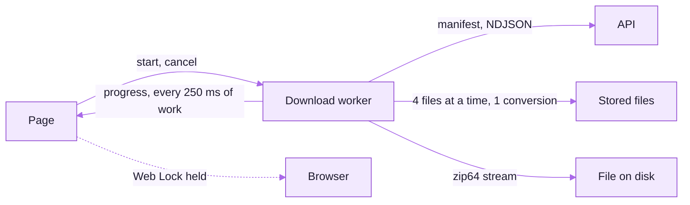

# Data explorer on the web (0.0.13)

The `/data` page in both portals is one shared client: `frontend/lib/dataExplorer/**` and
`frontend/components/dataExplorer/**`, byte-identical, edited in designer-portal and copied with
`python scripts/sync_data_explorer.py --to ../documentation-portal`. The page file in each portal only
supplies what differs (the review-status filter in the documentation portal, the design-workshop notes
in the designer portal, the record links). Proposal and owner decisions:
`C:/dev/IIT/docs/data-explorer/PROPOSAL_2026-11-04.md`.

## Layout

Approved mockups: `Main`, `WebTables`, `WebSearch`, `WebTablet`, `WebPhone`, `WebPreview`,
`WebTranscripts`, `States`, `WebTrayQueue`, `PhoneTables`, `WorkshopOverview`, `CommandPalette`,
`ReportOptions`, `WebAudio` and `SearchBoth` (owner-approved 2026-11-05).

| Place | What it holds |
|---|---|
| Top | the search card (each portal's own panel, `ExplorerConfig.renderSearch`): one box, always-visible filters, This portal / Both portals, grouped result pills, highlighted snippets, *Play from mm:ss*, *Open in Data*, *Show 20 more*; it falls back to the legacy search when unified search is off |
| Left (behind *Folders* below `lg`) | Organise by, then the folder tree (40 px rows, item counts once a folder is known) |
| Right | the folder card (breadcrumb, size, *Report (.xlsx)*, *Download folder · size*, the size-by-type tiles that choose what a download includes), the record details, the workshop overview on a workshop folder, then one tab strip: **Files**, **Tables**, **Transcripts** |
| Bottom | the sticky selection bar, the downloads tray, the mini player |
| Under both | Browse by type and Transcripts data |

Active and selected states are a full background tint; nothing draws a side stripe. Saved files and
rows are green (`bg-success-100`, `border-green-300`, `text-green-900`), failed ones red
(`bg-error-100`, `border-red-300`, `text-red-900`); work in progress stays neutral.

The folder, view, sheet, table search, browse type, page, preview, time (`t`) and find term live in
the URL, so Back works and a moment in a recording can be shared as a link. Every navigation builds on
the last one still in flight, so two quick changes (a table search and a Browse-by-type search) never
overwrite each other. A saved view (`/data?viewId=`) restores folder, tab, sheet and search for anyone
who can see the folder.

## One downloads tray

Every download goes through the tray: folder and selection zips (the worker below), the `.xlsx`
report, a sheet's CSV, a single file, a transcript in every format. One job runs at a time, the rest
wait with *Start now*; a failed job says what happened and *Retry* picks up a file from the byte it
stopped at (never a report, which is rebuilt). The report is fetched, its status and zip signature are
checked, and only then is it saved, so an error page can never land on disk as a `.xlsx`. A busy server
retries by itself with a countdown and *Try now*. Closing the tab while anything runs asks first.

## Downloads keep going in a background tab

- The whole pipeline (listing, fetching, zipping, writing) runs in a dedicated Web Worker. Nothing is
  paced by a timer or by `requestAnimationFrame`, so a hidden tab does not slow it. While the tab is
  hidden the page keeps the latest progress and draws it when the tab comes back.
- Chromium writes straight to the file the person chose (File System Access), so a 7 GB zip never sits
  in memory. Firefox hands the stream to the browser's own download manager through
  `public/download-stream-sw.js`. Other browsers build the zip in the worker up to a limit (Safari 1 GB,
  iOS 512 MB) and say so before starting.
- A shared Web Lock (`data-explorer-download`) is held for the whole job, so Chrome does not freeze the tab.
- A single file, a transcript in every format (`format=zip`) and a folder's transcripts
  (`/data/transcript-bundle`) go straight to the browser's download manager.
- Each file is tried three times and resumed with a `Range` request. A file that still fails is left out
  of the zip (a half-written entry is kept out of the zip's directory) and listed in
  `_failed-downloads.txt` and on screen. Audio converted to `.mp4` that the server answers with
  `X-Conversion: original` is saved under its real name.
- The engine reads 408 and 429 as worth another try and any other 4xx as final itself, because it runs in
  the worker and must not import the page-side failure table; `failure-triage-unit.spec.ts` lists it.
- **Save to a folder** writes each file on its own and keeps `.download-progress.json` in the folder
  until the job finishes, so running it again into the same folder skips what is already there.
- Cancel stops the worker at once; leaving the page mid-way asks first.

## Tables

Subfolder tables load on their own; the repository root loads on click. Moving between folders keeps
the previous folder's tables on screen with a spinner until the new ones arrive; nothing remounts.
Answers are kept per folder, review status and viewer (16 folders, 24 MB, 10 minutes). The search box
searches every row of every sheet on the server and shows each sheet's matches; the server answers it
from the report it already built for that folder and data version, so a search never rebuilds the
report. On a phone a sheet picker replaces the side list and rows read as cards.

*Report (.xlsx)* opens the options: sheets, answers in Original / English / Both, every row or only the
filtered ones, file links, the file name, and *Remember these choices* (stored per account).

## How this document is kept true

| Claim | Kept true by |
|---|---|
| The shared trees are identical in both portals | `data-explorer-web-imports-unit.spec.ts`, `shared/data-explorer-web.sha256` |
| Zip64, resume, the failed list, 4 + 1 concurrency, folder resume | `data-explorer-engine-unit.spec.ts` |
| Bytes still arrive with the tab hidden, under a held Web Lock | `data-explorer.spec.ts` |
| The layout at three sizes in both themes | `data-explorer.spec.ts` (screenshots in the run's artefact) |

## The tests

| Spec | What it holds |
|---|---|
| `frontend/e2e/data-explorer-engine-unit.spec.ts` | zip and zip64 records, resume, the failed list, 4 + 1 concurrency, streaming without holding a file, folder resume, selection, URL state, table memory, one request per file |
| `frontend/e2e/data-explorer.spec.ts` | the layout on desktop, tablet and phone in light and dark, the tree keyboard, downloads to disk, bytes still arriving with the tab hidden, Cancel, previews, thumbnails, table search, browse paging, languages |
| `frontend/e2e/data-explorer-web-imports-unit.spec.ts` | the shared trees import only what both portals carry, and match the other portal |
| `frontend/e2e/data-explorer-redesign-unit.spec.ts` | the tray's states and colours, the fetched-and-checked `.xlsx`, Range resume for files only, paging, the navigation merge, report options, saved views, workshop coverage sorting, the palette's search |
| `frontend/e2e/data-explorer-preview-unit.spec.ts` | find N of M, the line at a playback time, talk time, waveform peaks, transcript status mapping |
| `frontend/e2e/data-search-panel-unit.spec.ts` (designer portal) | the search card's times, groups, portal counts, filters and legacy fallback |

Feature ids for the parity registry are `X1`–`X12` (`shared/data-explorer-contract.json`); the web
tests carry `@qf:<id>`.
